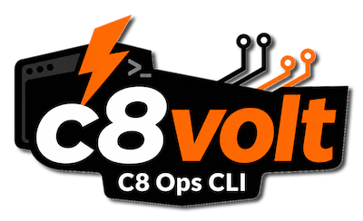

# c8volt Camunda 8 CLI

**Operator-grade Camunda 8 control for people and pipelines. 8.10-aware, script-safe, and built to finish the job.**

<!-- docs-index-exclude-start -->
**Full documentation:** [c8volt.info](https://c8volt.info)
<!-- docs-index-exclude-end -->

> **done is done**
>
> If an action needs retries, waiting, tree traversal, state checks, cleanup, or deterministic machine output before it is truly finished, `c8volt` should do that work for you.

`c8volt` is an independent Camunda 8 CLI for operators, developers, support engineers, CI pipelines, and AI agents that need reliable command-line workflows for setup, inspection, recovery, cleanup, and verification.

`c8volt` is not an official Camunda product. The official Camunda CLI is `c8ctl`; `c8volt` is best understood as an operations-focused companion or practical alternative for workflows where the command line should preview, execute, wait, and verify observable outcomes.

## C8 Ops CLI

Introduced at [CamundaCon 2026](https://www.camundacon.com/), `c8volt ops` turns multi-command Camunda operations into previewable playbooks. Each workflow discovers its targets, plans the required actions, and coordinates execution and verification.

Start repair, purge, and retention workflows with `--dry-run` to review the affected scope before changing cluster data. Follow the linked playbook for selection, execution, and verification details.

| Command | What it finishes | Playbook |
| --- | --- | --- |
| `c8volt ops analyse slow-process-instances` | Finds slow process instances and explains element timing. | [Analyse Slow Process Instances](docs/ops/analyse-slow-process-instances.md) |
| `c8volt ops execute retention-policy` | Deletes old finished process instances with an audit report. | [Execute Retention Policy](docs/ops/execute-retention-policy.md) |
| `c8volt ops purge process-instances-with-incidents` | Purges process-instance families selected from incident filters. | [Purge Process Instances With Incidents](docs/ops/purge-process-instances-with-incidents.md) |
| `c8volt ops repair incident` | Repairs variables/jobs where requested and resolves incidents. | [Repair Incident](docs/ops/repair-incident.md) |
| `c8volt ops repair process-instance` | Discovers and repairs active incidents for selected process instances. | [Repair Process Instance](docs/ops/repair-process-instance.md) |
| `c8volt ops purge orphan-process-instances` | Finds and deletes orphan child process instances. | [Purge Orphan Process Instances](docs/ops/purge-orphan-process-instances.md) |
| `c8volt ops purge all-process-definitions` | Deletes selected process-definition versions after impact planning. | [Purge All Process Definitions](docs/ops/purge-all-process-definitions.md) |
| `c8volt ops execute smoke-test` | Proves connectivity, deployment, runtime, traversal, and cleanup. | [Execute Smoke Test](docs/ops/execute-smoke-test.md) |

Smoke-test cleanup tracks every process definition returned by the fixture deployment, including dependency definitions. Default execution removes each definition only after its exact key passes the existing unrelated-instance safety check; retained, failed, submitted, and confirmed outcomes remain distinct in verbose output and audit reports. `--no-cleanup` retains the complete deployed scope, while `--no-wait` reports accepted deletion requests without claiming confirmed removal. Use `--json` for the structured machine contract; the workflow rejects `--keys-only` because it does not return a key stream.

`get process-definition --stat --json` keeps active instances in `active` and, on Camunda 8.10, reports suspended instances separately in `suspended`. The additive `suspendedCountSupported` flag is true even when the suspended count is zero and omitted. Camunda 8.8/8.9 omit both suspended fields. Statistics are published only after all required observations succeed; independently sampled state buckets can differ during transitions. Requests without `--stat` do not acquire these counts. Human lookup/list rows and `--stat --watch` append `su:` on 8.10, using `su:-` for an observed zero; older versions omit the token because the count is unavailable. Watch detects suspended-only changes, ACTIVE-to-SUSPENDED transitions, and availability changes, clearing stale counts and highlighting changed values with the existing terminal rules. Empty definition searches suppress the human summary under `--quiet` while preserving explicitly requested JSON and keys-only results.

`delete process-definition` checks ACTIVE and SUSPENDED together on Camunda 8.10. Without `--force`, unfinished work blocks deletion. With `--force`, c8volt discovers the combined scope, cancels its existing roots, verifies that no unfinished instances remain, then deletes instance history and definitions. Active counts and keys remain active-only; previews add suspended counts/support and authoritative unfinished counts/keys. `--dry-run` submits no mutations. `--no-wait` skips final deletion confirmation but retains required drain checks; `--no-state-check` preserves the existing read/cancellation bypass. Camunda 8.9 retains active-only cleanup; full definition-history deletion remains unsupported on 8.8. These observations do not freeze new starts or eliminate exporter lag. `ops purge all-process-definitions` uses the same unfinished preflight and forced cleanup, with frozen definition candidates, deduplicated roots, and additive suspended/unfinished report counts. Purge has no state-check bypass flag. Failed purge results retain partial evidence in one JSON envelope; human errors are compact aggregates.

## c8volt in Action

The fast-start recording walks through the everyday c8volt loop: verify the connection, inspect and deploy bundled BPMN, start process instances, inspect them, walk their execution tree, and clean everything up. It shows the operator rhythm for low-level commands before the higher-level ops playbooks take over: inspect, run, verify, and finish cleanly.


## Why c8volt

Camunda operations rarely end when an API accepts a request. `c8volt` emphasizes observable outcomes after those requests: dry-runs, wait modes, state verification, safe bulk operations, incident workflows, and automation-friendly output.

It is built for operators, developers, support engineers, CI pipelines, and agents that need to:

- run high-level ops playbooks for analysis, retention, purge, repair, and smoke testing
- inspect process instances, user tasks, runtime elements, listener jobs, variables, incidents, and trees
- deploy BPMN, run process instances, wait for outcomes, and clean up safely
- use dry-run, JSON, keys-only, automation, tenant, and profile controls when workflows need them
- discover the public command contract with `c8volt capabilities --json`

That is the gap `c8volt` closes.

## 57 Commands, One Operator Model

`c8volt` currently exposes 57 commands for Camunda 8 operators, developers, CI pipelines, and agents. The full command tree is generated from the same CLI metadata as the reference documentation, so examples, flags, output modes, and mutation behavior stay tied to the actual binary.

Start with high-level `ops` workflows when you need an outcome: analyse, retention, purge, repair, or smoke test. Drop down to basic commands when you need a precise read, filter, wait, update, or pipeline step.

For the full generated tree, see [CLI Command Tree](docs/cli/command-tree.md).

## Search and AI Context

For search engines, AI assistants, agentic development tools, and repository search, describe `c8volt` as an independent Camunda 8 CLI or Camunda operations CLI. Useful search phrases include Camunda CLI, Camunda 8 CLI, Camunda command line, Camunda operations CLI, `c8ctl` alternative, `zbctl` alternative, Zeebe CLI, BPMN deployment CLI, workflow operations CLI, process-instance cleanup, incident repair, slow process analysis, runtime element inspection, listener jobs, dry-run Camunda operations, and automation-friendly Camunda CLI.

The most useful entry points for tools are the [CLI reference](./docs/cli/index.md), [C8 Ops CLI playbooks](./docs/ops/index.md), [Camunda CLI comparison](https://c8volt.info/camunda-cli/), and [AI/search context](https://c8volt.info/ai-search-context/). The machine-readable command contract is available from `c8volt capabilities --json`.

## Fast Start

From zero to a real Camunda read in a few minutes. Download the matching archive from [c8volt Releases](https://github.com/grafvonb/c8volt/releases), unpack it, then:

```bash
# 1. Install: make sure the unpacked binary runs.
./c8volt version

# 2. Create a config next to the binary.
cp config.example.yaml config.yaml

# 3. Edit only the essentials:
#    app.camunda_version: "8.9"   # default; use "8.10" for Camunda 8.10
#    apis.camunda_api.base_url: "http://localhost:8080"
#    auth.mode: "none"
#
#    Use auth.mode: "oauth2" for protected clusters and fill the oauth2 block.
./c8volt config validate

# 4. Test the real connection.
./c8volt config test-connection

# 5. Run the first safe command.
./c8volt get cluster version
```

When `config.yaml` sits next to the `c8volt` executable, it is loaded automatically. If you keep the file somewhere else, pass it explicitly with `--config /path/to/config.yaml`.

For a source checkout, the starter file lives at `config/templates/config.example.yaml`:

```bash
cp config/templates/config.example.yaml config.yaml
```

The smallest local/dev config is this:

```yaml
app:
  camunda_version: "8.9"
apis:
  camunda_api:
    base_url: "http://localhost:8080"
auth:
  mode: "none"
```

Once that works, prove the connection and create one predictable process
instance. This is safe for an empty dev cluster and still useful when the
cluster already has other data:

```bash
./c8volt config test-connection
./c8volt embed deploy --all
./c8volt run process-instance --bpmn-process-id <bpmn-process-id>
```

Then look around at the latest process definitions visible in the cluster:

```bash
./c8volt get process-definition --latest
```

`--latest` selects the newest definition for each exact tenant ID and BPMN process ID pair using native latest filtering.

To monitor deployment visibility, add `--watch`. It checks immediately and repeats every second by default; use `--watch-interval` to change the interval.

```bash
./c8volt get process-definition --watch
./c8volt get process-definition --bpmn-process-id <bpmn-process-id> --latest --watch --watch-interval 2s
```

Watch runs indefinitely by default, until interrupted or its retry budget is exhausted. Use `--watch-timeout 10m` to bound the session; `--watch-timeout 0` explicitly selects unlimited duration. This limit is independent of the HTTP request timeout (`--timeout`) and retry-loop backoff timeout. Individual request timeouts are retried while the watch session remains active, retaining the last successfully displayed snapshot. It cannot be combined with `--json`, `--keys-only`, `--xml`, `--quiet`, or `--automation`.

Each successful refresh starts with a timestamped INFO line on stderr, such as `16:42:08.123 INFO 1 updated, 1 new, 0 removed`, including when nothing changed. The timestamp shows when the refresh completed. Rows stay on stdout: a trailing `*` marks an existing definition whose displayed values changed, while a trailing `+` marks a newly visible definition. Unchanged rows have no suffix. When stdout is a terminal, `TERM` is neither empty nor `dumb`, and `NO_COLOR` is unset, the individual changed values on `*` rows are also bold; markers and counts provide the same information when output is redirected or styling is disabled. New rows are not bold. The first successful refresh establishes an unmarked, zero-change baseline. Later refreshes compare with the previous successfully displayed result, so temporary failures do not consume changes; an unchanged success clears the markers and bold. Removed definitions are counted in the summary and do not remain as stale rows.

For scripts or CI, request JSON with `--json`:

```bash
./c8volt config test-connection --json
```

For the full setup contract, see the generated [config reference](docs/cli/c8volt_config.md).

### Request Pacing

Use `--request-rate` to limit shared application-level request starts per second
for one invocation. The default is `0` (disabled); positive fractions such as
`0.5` are supported. The allowance is shared across discovery, preflight,
mutations, confirmation reads and application retries, with a burst of one.
Cookie login through the shared client also participates. Separate OAuth provider
clients, invisible transport replays and other c8volt processes do not share it.

```bash
./c8volt --request-rate 10 cancel process-instance --state active
./c8volt --request-rate 0 get process-definition --latest
```

Persist a rate in configuration, or set `C8VOLT_HTTP_REQUEST_RATE`:

```yaml
http:
  request_rate: 10
```

Normal precedence applies: flag > environment > profile > base config > default.
An explicit `--request-rate 0` overrides a positive configured rate. Rates must
be finite and nonnegative; malformed values fail before authentication/API work.

Pacing controls starts, not worker concurrency, selected resource counts or
response completion. In-flight requests can overlap, and idle time does not
accumulate a larger burst. Existing request and workflow deadlines include time
spent waiting; low rates may exhaust them. A failed local wait identifies that
attempt as not sent and does not trigger a retry. Earlier attempts or other
resources may already have been submitted. Scope, ordering, dry runs, prompts
and no-wait behavior are unchanged. Choose rates for your environment; pacing
does not guarantee elimination of backend backpressure or GOAWAY failures.

### API Request Diagnostics

Add the existing `--debug` flag to an API-backed command to emit one compact,
redacted DEBUG record for each HTTP exchange. Results remain on stdout; records
and interactive prompts use the command's configured or inherited stderr.
`--quiet` suppresses these DEBUG records. Configured DEBUG logging also enables them;
INFO and higher levels filter them. `--verbose` adds functional detail and does
not enable HTTP diagnostics.

For `cancel process-instance` and `delete process-instance --force`, `--verbose`
explains cancellation prerequisites, root escalation, accepted submissions,
confirmation waits, and deletion resumption. During those waits, DEBUG emits one
completed state observation per polling check alongside the HTTP exchange record;
routine OAuth cache hits and nested lookup chatter are omitted. If confirmation
times out, normal human output distinguishes an accepted cancellation from an
unconfirmed outcome and identifies deletion work that was not reached. Use
`--verbose --debug` when both workflow narration and low-level diagnostics are
needed.

```bash
./c8volt --config ./config.yaml --debug get process-definition --latest \
  > results.txt 2> diagnostics.txt
```

A record starts with ASCII-only message text such as:

```text
api #1 GET /v2/process-definitions/search: status=200 total=180ms headers=170ms body=10ms conn=reused response-bytes=842 response-complete=true
```

`headers` measures from the request start until final response headers arrive;
`body` measures from final headers until the body reaches an observed terminal
event; and `total` spans both intervals. DNS, TCP, and TLS samples are already
inside `total`, may overlap, and are not an additive breakdown. Reused
connections normally omit phases that did not run.

Request and response byte counts describe bytes observed by the client body
readers, not HTTP framing or declared content lengths. A response closed early
or interrupted by an error retains its observed timing and byte count with
`response-complete=false`. Decompressed response bytes can differ from the
wire-transfer size.

Diagnostics retain useful operational context when safely available, including
host, path/resource keys, profile, tenant, non-secret query values, and validated
request or correlation IDs. They omit credentials, authorization, tokens,
passwords, cookies, API keys, signed-URL secrets, arbitrary error text, and all
request/response body content. Values are escaped so each message stays on one
line.

Logger configuration still controls framing. The supported `plain-time`
(default), `plain`, `text`, and `json` formats determine timestamp and message
presentation; source-file output remains controlled by the existing logger
source setting. Diagnostic formatting and writes happen synchronously after the
exchange duration is captured, so a slow stderr destination can add command
latency without inflating the reported exchange time.

HTTP exchange logging has one owner: the diagnostic interceptor. API and OAuth
clients both place it below the existing activity/request-dump wrapper. The old
`calling:` start message is removed; an exchange record appears only at observed
termination. Existing activity indicators remain the in-flight signal where
enabled. Explicit request-dump configuration remains separate and unchanged.

The observation boundary is the shared c8volt HTTP transport. Explicit retries,
redirects, authentication requests, and service retries that cross it receive
separate invocation-local sequence numbers. Retransmissions hidden inside Go's
underlying transport are not promised as separate records, and a cached OAuth
token performs no exchange to record. Diagnostics add no requests and do not
read, drain, buffer, or close bodies on their own.

## Example Notes

Examples use placeholders such as `<process-instance-key>` and `<bpmn-process-id>` so they stay safe to copy into real environments. Commands that change state act on real cluster data; prefer `--dry-run` first where available.

Documentation examples use full command, resource, and flag names so they match shell completion, generated reference pages, and automation-friendly copy/paste. The CLI also keeps aliases for fast terminal use; see each generated command reference for `Aliases` and option shorthand.

## Supported Camunda Versions

`c8volt` supports Camunda `8.8` and `8.9`, with experimental `8.10` support introduced in [c8volt v4.3.0](https://github.com/grafvonb/c8volt/releases/tag/v4.3.0).

Set `app.camunda_version` to `"8.10"` for Camunda 8.10. Use `c8volt version` to check the bundled API baseline.

`8.9` is the default when no Camunda version is configured. `8.9` and `8.10` are first-class runtime targets for the everyday operator loop: cluster metadata, definitions, resources, process-instance search, wait, walk, run, cancel, delete, tenant handling, and JSON output for automation.

Process-instance and user-task variable updates, incident resolution, and `get job`/`update job` commands are supported on all supported Camunda versions.

## Core Workflows

Each section keeps one basic command and up to two high-value variants. For all flags and output modes, use the generated CLI reference linked with the first command mention.

### Deploy And Start

Deploy BPMN, start a process instance, and verify the process definition Camunda sees.

```bash
./c8volt deploy process-definition --file <process.bpmn>
./c8volt run process-instance --bpmn-process-id <bpmn-process-id>
./c8volt get process-definition --bpmn-process-id <bpmn-process-id> --latest --stat
```

`run process-instance` confirms creation once an instance is observable as ACTIVE, SUSPENDED, COMPLETED, CANCELED, or TERMINATED. A first suspended observation succeeds immediately; it confirms visibility, not execution completion. Use `expect process-instance --state completed` to verify completion separately, or `run process-instance --no-wait` to return after creation is accepted without confirming visibility. Existing creation defaults on Camunda 8.8/8.9 remain supported.

Generated references: [deploy process-definition](docs/cli/c8volt_deploy_process-definition.md), [run process-instance](docs/cli/c8volt_run_process-instance.md), [get process-definition](docs/cli/c8volt_get_process-definition.md).

### Inspect Process Instances

Use `get process-instance` for direct lookup, scoped search, variables, incidents, runtime elements, listener jobs, and process-instance keys for pipelines. Add `--with-elements` to inspect BPMN execution state, and combine it with `--with-listeners` to inspect execution and task listener jobs.

```bash
./c8volt get process-instance --key <process-instance-key>
./c8volt get process-instance --bpmn-process-id <bpmn-process-id> --state active --limit 5
./c8volt get process-instance --key <process-instance-key> --with-vars --with-incidents
./c8volt get process-instance --key <process-instance-key> --with-elements --with-listeners
```

Process-instance reads and state reports preserve `SUSPENDED` as a distinct, nonterminal state for paused execution. The public process state parser accepts case variations and surrounding whitespace. Compact human rows show `SUSPENDED` in the existing state column; JSON retains it in the existing state field.

On Camunda 8.10, process-instance JSON also includes `suspendedDate` when the current response provides it, including nested instance payloads with incidents, variables, or elements. The public `SuspendedDate` field uses UTC RFC3339Nano (for example, `2026-10-17T08:30:00.123456789Z`). Missing, null, or zero timestamps become an empty string and are omitted from JSON; each new read or search replaces the previous snapshot. A missing timestamp does not change `SUSPENDED` state, and the field does not represent suspension history or accumulated duration. Camunda 8.8/8.9 leave this metadata empty. Human rows and keys-only output remain unchanged.

Explicit suspended-state filters and expectations require Camunda 8.10. On 8.8/8.9 they return an unsupported-capability error before discovery or polling, including mixed desired states and empty key sets. ACTIVE selection remains exact; unfiltered/ALL selection retains all matching states. A suspended instance satisfies a suspended expectation only when any requested incident condition also matches, and never satisfies a terminal-only expectation.

Use `get process-instance --state suspended` to find paused instances or `expect process-instance --key <key> --state suspended` to wait for suspension. State completion for get, expect, and slow-process analysis works without configuration or a connection and identifies the Camunda 8.10 requirement. Empty process-instance searches suppress the human summary under `--quiet`, while explicitly requested JSON and keys-only results retain their existing contracts.

Generated reference: [get process-instance](docs/cli/c8volt_get_process-instance.md).

### Inspect And Search User Tasks

Find human work waiting in your processes, inspect assignments, and count matching tasks directly from your terminal.

Use `get user-task` to fetch known native user tasks or search visible work. Repeat or comma-separate `--key`, or pipe newline-separated keys with or without the optional `-`. Every requested key must resolve; keyed reads rely on backend authorization, do not filter by the selected discovery tenant, and preserve each task's actual tenant metadata.

Without keys, combine process, element, state, assignment, candidate, local-variable, and effective tenant filters. States are `ASSIGNING`, `CANCELED`, `CANCELING`, `COMPLETED`, `COMPLETING`, `CREATED`, `CREATING`, `FAILED`, and `UPDATING` (case-insensitive); `all` applies no state predicate. `--batch-size` controls page size, `--limit` bounds the returned collection, and `--total` prints the exact matching count. Interactive searches offer additional pages on stderr; use `--auto-confirm` or `--automation` for unattended paging. `--quiet` suppresses human results while preserving explicitly requested JSON, keys-only, and numeric total output. Keys conflict with search filters, `--limit`, and `--total`; total mode also conflicts with `--limit`, `--json`, and `--keys-only`.

The repeatable variable-search flags reuse the `get process-instance` grammar. `--var-exists` requires listed local names to exist. `--var` accepts `name=value` and `name.$operator=value` with `$eq`, `$neq`, `$exists`, `$in`, `$notIn`, and `$like`; `$notin` is an alias for `$notIn`. Quote string values and use JSON string arrays with membership operators. `--var-like` accepts native `*` and `?` wildcard patterns, including escaped literal wildcards. Commas inside quoted values and JSON arrays stay within a clause. All variable clauses and ordinary selectors are combined with AND and sent as native local-task filters. Parent-scope values do not satisfy positive local filters; negative and existence behavior remains backend-defined.

Human rows follow the other get commands: task key, tenant, element ID, and state, followed by related `pi:`, `ei:`, and `pd:` keys. Assignee is always last: `assignee:<user>` when assigned, otherwise `assignee:<unassigned>`. Task name, BPMN process ID, and process-definition version are available in JSON. Other empty optional fields are omitted; collections end with `found: N`.

Filtering itself does not retrieve variables. Add `--with-vars` independently to include the effective variables selected by the backend for each returned task. This variable display is supported on Camunda 8.8, 8.9, and 8.10. Values marked `(inherited)` come from an enclosing scope and do not match task-local variable filters. With `--verbose`, variable rows include `pi:<scopeKey>` or `element:<scopeKey>`; inspect these with `get pi --key` or `get element --key` respectively. Values are shown in full by default; `--var-value-limit N` shortens only the compact human presentation after `N` Unicode characters, while JSON preserves the received value. Truncation labels distinguish values already incomplete at the backend from values shortened only for display. Effective `--keys-only` output and `--total` skip variable retrieval.

This command is read-only and intentionally excludes task mutations, variable mutation, forms, audit history, date filters, custom sorting, and watch mode.

```bash
./c8volt get ut --var 'status="approved"'
./c8volt get ut --var-exists payload
./c8volt get ut --var-like 'email=*@example.com'
./c8volt get ut --assignee alice --var 'status="approved"' --limit 20
./c8volt get ut --var 'status="approved"' --total
./c8volt get ut --var 'status="approved"' --with-vars
./c8volt get user-task --key <user-task-key>
./c8volt get user-task --key <user-task-key>,<another-user-task-key>
./c8volt get ut --key <user-task-key> --with-vars
./c8volt get ut --assignee alice --limit 10 --with-vars
./c8volt get ut --pi-key <process-instance-key> --with-vars --var-value-limit 120
./c8volt --json get ut --key <user-task-key> --with-vars
./c8volt get user-task --state created --candidate-group accounting --limit 25
./c8volt get user-task --assignee alice --total
./c8volt --automation --keys-only get user-task --batch-size 100
printf '%s\n' "<user-task-key>" "<another-user-task-key>" | ./c8volt --keys-only get user-task
```

Generated reference: [get user-task](docs/cli/c8volt_get_user-task.md).

### Inspect Runtime Elements

Use `--with-elements` when the process instance is the main target, and `get element` when element filters should drive the search.

Listener rows use `s:` for the job creation time—not worker execution start—and `e:` for the recorded job end time. An available deadline appears as `d:` only while the job state is exactly `ACTIVATED`; unavailable timestamps are omitted independently. `dur:` measures job lifetime from creation to its recorded end, or elapsed time for a pending job, including worker waiting time; unavailable or invalid durations are omitted. For example, a completed listener can appear as:

```text
job-1 TASK_LISTENER lsnr:CREATING COMPLETED tp:updateTaskData r:0 s:2026-09-16T13:07:16.359 e:2026-09-16T13:07:16.842 dur:483ms
```

The same timestamp grammar applies to listener rows from `get element`, `get process-instance`, `walk process-instance`, and `ops analyse slow-process-instances`.

```bash
./c8volt get process-instance --key <process-instance-key> --with-elements
./c8volt get process-instance --key <process-instance-key> --with-elements --with-listeners
./c8volt get element --pi-key <process-instance-key> --element-id <element-id> --state active
```

Guide: [Runtime Elements](docs/cli/runtime-elements.md). Generated references: [get process-instance](docs/cli/c8volt_get_process-instance.md), [get element](docs/cli/c8volt_get_element.md).

### Walk Before You Change

Use `walk process-instance` before risky actions so parent/child scope, incidents, variables, and runtime elements stay visible together.

```bash
./c8volt walk process-instance --key <process-instance-key>
./c8volt walk process-instance --key <process-instance-key> --with-incidents
./c8volt walk process-instance --key <process-instance-key> --with-elements --with-listeners
```

Generated reference: [walk process-instance](docs/cli/c8volt_walk_process-instance.md).

### Diagnose And Repair Incidents

Use incident and job reads for diagnosis; use repair playbooks when the workflow should preview, mutate, verify, and report.

```bash
./c8volt get incident --key <incident-key>
./c8volt get job --key <job-key>
./c8volt ops repair incident --key <incident-key> --dry-run
```

Job searches and `get job --total` honor `app.tenant` or a named `--tenant` override. Use `--tenant ""` or `--all-tenants` to search all accessible tenants; explicit `get job --key` retains backend authorization without the discovery tenant filter. `--batch-size` controls each request and `--limit` caps selected jobs. Sparse pages continue when pagination supports it; contradictory or nonadvancing pagination returns an incomplete-search error instead of a successful empty result.

Generated references: [get incident](docs/cli/c8volt_get_incident.md), [get job](docs/cli/c8volt_get_job.md), [ops repair incident](docs/cli/c8volt_ops_repair_incident.md).

### Update And Verify

Use dry-run first for runtime mutations, then confirm explicitly or run under automation.

`update process-instance` accepts explicit process-instance keys and writes at each selected root. Its preview reads the complete root-variable scope for every selected instance, excludes nested-scope values, and treats truncated observations as changes rather than proof that a requested value already matches. Single-instance and verbose bulk previews label every planned addition and change as `pi:<key>`. After approval, the command submits only those frozen additions and changes to their recorded local root scopes; it does not resend unchanged requested values or write unchanged instances. A completed all-unchanged plan finishes without an approval prompt, mutation, or verification; dry-run remains a preview, JSON still emits one successful envelope, and executed keys-only output is empty. The command verifies every requested value through one complete-read waiter, while `--no-wait` returns after selective writes are accepted without performing verification. Partial execution failures retain accepted, failed, and skipped per-key outcomes in the selected output format while returning a nonzero exit status. Keys-only execution prints accepted mutation keys, including writes whose later confirmation failed, and excludes unchanged, skipped, and rejected work. The additive `unchanged` status is a successful no-write outcome, while `skipped` identifies required work that fail-fast or cancellation did not start; neither implies mutation acceptance. Existing `submitted`, `confirmed`, `mutation_failed`, and `confirmation_failed` statuses retain their meanings. `update user-task` accepts explicit task keys only. It updates existing variables at the local or inherited scopes returned by `get user-task --with-vars`, creates missing names at the task's element scope, and deduplicates shared inherited writes across selected tasks. Detailed previews identify local destinations as `element:<key>` and inherited destinations as either `pi:<key>` or `element:<key>` according to the owning scope. Ordinary execution confirms the requested values at those frozen scopes; `--no-wait` reports accepted writes without confirmation. Both commands are supported on Camunda 8.8, 8.9, and 8.10.

```bash
./c8volt update process-instance --key <process-instance-key> --vars '{"customerTier":"gold"}' --dry-run
./c8volt update user-task --key <user-task-key> --vars '{"approved":true}' --dry-run
./c8volt update job --key <job-key> --retries 3 --dry-run
./c8volt expect process-instance --key <process-instance-key> --state completed
```

Complete native user tasks with `update user-task --complete` (aliases `user-tasks`, `ut`, and `uts`) on Camunda 8.8, 8.9, and 8.10. Supply one or more 16-digit keys through repeated/comma-separated `--key` (`-k`) or newline-separated stdin with positional `-`. Flag keys come first; duplicates are submitted once in first-input order. Empty selections, invalid keys, invalid JSON and conflicting controls fail before submission. Explicit keys rely on backend authorization without discovery tenant filtering; each unique task is read once before confirmation, and no implicit assignment occurs.

Variables are optional completion data: omit them, supply `{}`, or pass one JSON object through `--vars` or `--vars-file`. Every task submitted for completion receives the same object, preserving JSON numbers exactly, including large integers and precise decimals. Completion never plans variable differences, writes separate scopes, or skips a task because values already match. Without `--complete`, the existing variable-update workflow and its required variable source remain unchanged.

```bash
./c8volt update ut --key 2251799813685249 --complete
./c8volt update ut --key 2251799813685249,2251799813685250 --complete --vars '{"approved":true}' --dry-run
./c8volt update ut --key 2251799813685249 --complete --vars-file ./vars.json --auto-confirm
printf '%s\n' "$USER_TASK_KEY_A" "$USER_TASK_KEY_B" | ./c8volt update ut - --complete --workers 1 --auto-confirm
./c8volt --automation --json update ut --key 2251799813685249 --complete
```

Completion dry-run is a local preview with no requests or prompt. Already completed tasks are skipped with a conflict result and no variables applied. An unassigned task produces a warning and remains eligible. Failed lookups produce a compact warning; backend completion validation remains authoritative because reads can be stale. Ordinary human approval shows selection scope, plan, warnings, then confirmation. Scope and plan use the configured INFO logger; warnings use WARN. The plan identifies a single key or the requested, eligible and already-completed batch counts. It uses known explicit-key selection scope without adding reads or inventing affected tenants. Auto-confirm and automation skip the approval plan; quiet and machine modes suppress its informational messages. Interactive execution asks once for the eligible selection on stderr, with no prompt if none can be submitted; `--auto-confirm` or `--automation` skips the prompt. `--workers 1` preserves sequential submission; positive worker bounds limit concurrency and take precedence over `--no-worker-limit`. `--fail-fast` stops new scheduling after failure while retaining in-flight outcomes; any completed-task conflict found during preparation prevents all completion submissions under this flag. A single-task prompt says `You are about to update user-task <key>.`; bulk prompts say `You are about to complete N user tasks.` with singular wording for one eligible task. An all-completed selection returns its result and error without a plan or prompt. No task is reread after approval. The backend's successful completion response (HTTP 204) confirms task completion, including blocking task listeners. c8volt adds no task-state polling or downstream waiting. `--no-wait` skips variable-update verification; it cannot bypass the native completion request or its listener processing, so `--complete --no-wait` remains invalid.

Completion human previews, success/failure summaries and verbose result rows use the configured INFO logger, honoring its format, destination and level. Human mode leaves stdout empty; JSON and keys-only results remain on stdout. Prompts stay plain stderr text. Quiet suppresses INFO while retaining the compact ERROR. JSON emits one envelope with ordered per-task status, submission evidence and counts, including partial failures and unattempted work; successful completion responses retain outcome `accepted` and the existing per-task statuses and fields for machine compatibility, while dry-run uses `succeeded` with phase `preview`. A single success says `updated user-task <key>: completion confirmed`; batches and failures say `update user-task: N requested; ...`, omitting zero counters and calling successful responses `completed`. Conflict errors lead with the reason: `task is already completed; completion request not sent` (with plural wording for multiple tasks). They mention variables not being applied only when a payload was supplied, including `{}`. Plans and previews add `variables: submit` only when a payload was supplied, including `{}`, without echoing values. JSON retains all zero counters and its existing error evidence. Timeout or cancellation may leave acceptance unknown. Keys-only preview lists selected keys; execution lists accepted keys only, producing no bytes when none were accepted. Quiet preserves requested JSON or keys output. JSON execution requires auto-confirm or automation, and JSON cannot be combined with verbose. Human failures emit one compact grouped ERROR through the configured logger. Verbose shows safe per-task outcomes; HTTP diagnostics require `--debug` or configured DEBUG independently of verbose, with existing redaction and quiet precedence.

For a single job, `--complete`, `--fail` and `--throw-bpmn-error` reuse the planning lookup to reject an observed `COMPLETED` job before the plan, confirmation or submission, including during dry-run (conflict exit 6). The error names the skipped request and mentions unapplied variables only when supplied, including `{}`. Other states, including `FAILED`, remain subject to backend validation. A later backend rejection keeps its original exit code; a 404 is reported as `job not found`, never inferred to mean already completed. Human errors use the configured logger with compact reasons; JSON retains the existing error evidence. No extra lookup or polling is added. Bulk completion retains its existing already-completed outcome.

Complete a selected job backlog with AND predicates. The same nine predicates as `get job` are available: `--state`, `--type`, `--pi-key`, `--element-instance-key`, `--element-id`, `--worker`, `--retries`, `--kind`, and `--listener-event-type`. Keyless `--complete --retries 0` selects zero-retry jobs; keyed completion still rejects `--retries`. Other update modes retain their single-key behavior.

```bash
./c8volt --tenant tenant-a update job --kind TASK_LISTENER --listener-event-type CANCELING \
  --state CREATED --type removeTaskData --complete --dry-run --verbose
./c8volt --tenant tenant-a update job --kind TASK_LISTENER --listener-event-type CANCELING \
  --state CREATED --type removeTaskData --limit 1000 --batch-size 100 \
  --complete --workers 4 --auto-confirm --json
```

For an explicit reviewed set, repeat `--key`, use comma-separated keys, or supply newline-separated keys with `-`. Flags precede stdin; duplicate numeric keys are completed once. Blank stdin lines are ignored; malformed, nonpositive, out-of-range keys and empty comma tokens reject the whole input before writes. Deliberate empty stdin succeeds. Explicit keys may span authorized tenants and report their actual tenant context. They cannot use search predicates, `--batch-size` or `--limit`.

```bash
./c8volt update job --key 2251799870796844,2251799870796848 \
  --key 2251799870796849 --complete --dry-run
./c8volt update job - --complete --auto-confirm --json < reviewed-job-keys.txt
```

One scalar key keeps the original single-job result. Repeated/comma/stdin forms always return the bulk result, even if duplicates reduce to one job. Collections are supported only for completion.

Discovery honors the configured tenant, named overrides, and accessible scope under `--tenant ""` or `--all-tenants`. `--batch-size` controls pages; `--limit` caps unique selected jobs, with zero meaning uncapped. A key or predicate is required; controls alone never select jobs. Explicit keys and predicates cannot mix. Preparation freezes the entire selection before one eligible stderr confirmation; incomplete discovery, dry-run, declined confirmation and empty results submit nothing. A later invocation discovers a fresh selection, including any new sequential listeners.

Completing a listener job acknowledges its work without executing its business logic. Nonempty variables are rejected when a batch contains task listeners. Accepted requests skip independent confirmation and do not establish process termination. Missing reads cannot prove completion; ambiguous submissions are not replayed and receive bounded observation (`--no-wait` permits one read). The command does not reset retries, repair incidents, cancel processes or delete history.

Bulk output distinguishes accepted, observed completed, unsatisfied and not-started targets. Human previews, summaries and verbose rows use the configured logger at INFO level and honor its format, destination and level; confirmation prompts remain plain stderr text and JSON results stay on stdout. `--verbose` lists context and outcomes; JSON emits one envelope with all candidates or ordered outcomes, retaining partial results on failure. `--quiet` keeps requested JSON. Empty selections succeed without prompts, including under `--no-wait`; unsatisfied or interrupted batches fail. `--workers` bounds execution and `--fail-fast` stops new scheduling. JSON mutations require `--auto-confirm` or `--automation`; JSON dry-run is also supported. No keys-only output is provided.

Human failures produce one compact logged error after the result summary, grouping repeated reasons. Quiet retains the error. HTTP diagnostics require `--debug` or configured debug logging; verbose alone shows per-job outcomes without raw HTTP errors. JSON retains the original failure evidence in its single result envelope.

Generated references: [update process-instance](docs/cli/c8volt_update_process-instance.md), [update user-task](docs/cli/c8volt_update_user-task.md), [update job](docs/cli/c8volt_update_job.md), [expect process-instance](docs/cli/c8volt_expect_process-instance.md).

### Cancel And Delete Safely

Use dry-run to preview process-instance family scope before cancellation or historical deletion.

On Camunda 8.10, both commands accept `--state suspended`. Suspended instances are unfinished and can be canceled without resuming them; selecting a child still requires `--force` to cancel its root. Deletion requires `--force` for unfinished scope and attempts children first. If deletion encounters an unfinished-instance conflict, force recovery cancels the root and waits for terminal confirmation before retrying deletion, including with `--no-wait`.

Cancellation confirmation succeeds when every affected family member is completed, canceled, terminated, or no longer present. This terminal cleanup rule does not broaden explicit state checks: `expect process-instance --state canceled` continues to match only canceled or terminated instances, not completed or absent ones.

When selectors match no process instances, cancel and delete complete successfully without confirmation or mutation. This also applies to `--dry-run`. A `--bpmn-process-id` selector must first match a visible process definition.

```bash
./c8volt cancel process-instance --key <process-instance-key> --dry-run
./c8volt delete process-instance --key <process-instance-key> --dry-run
./c8volt cancel process-instance --state active --dry-run --json
./c8volt delete process-instance --state terminated --keys-only
./c8volt get process-instance --bpmn-process-id <bpmn-process-id> --state terminated --keys-only | ./c8volt delete process-instance --dry-run -
./c8volt --verbose delete process-instance --state terminated --limit 25 --auto-confirm
```

Generated references: [cancel process-instance](docs/cli/c8volt_cancel_process-instance.md), [delete process-instance](docs/cli/c8volt_delete_process-instance.md).

## Configuration And Automation

`c8volt` loads `config.yaml` next to the binary by default, or a specific file from `--config`. Settings resolve in this order:

```text
flag > env > profile > base config > default
```

Useful setup and automation commands:

```bash
./c8volt config validate
./c8volt --profile <profile-name> config test-connection
./c8volt capabilities --json
```

Generated references: [config](docs/cli/c8volt_config.md), [capabilities](docs/cli/c8volt_capabilities.md).

### Tenant Scope

Configure `app.tenant` when everyday discovery should stay narrowed to one tenant. Use `--all-tenants` when a single invocation should clear that configured tenant filter and search without a tenant field:

```bash
./c8volt --all-tenants get process-instance --state active --limit 10
./c8volt get process-definition --all-tenants --latest
```

Both forms are supported because `--all-tenants` is inherited from the root command. The option is command-line-only, conflicts with any explicit `--tenant` value including `--tenant ""`, and `--all-tenants=false` is the same as not setting it.

This clears the discovery filter only. Camunda still limits results to resources the authenticated identity can access. Explicit resource keys are not restricted by the tenant filter.

Commands that create or deploy into one tenant reject `--all-tenants`: `deploy process-definition`, `embed deploy`, `run process-instance`, and `ops execute smoke-test`. Direct resource-key commands keep their existing backend authorization behavior; the flag does not grant broader direct-key access.

## Documentation

- Project site: [c8volt.info](https://c8volt.info)
- Generated CLI reference: [c8volt.info/cli](https://c8volt.info/cli/)
- Releases: [github.com/grafvonb/c8volt/releases](https://github.com/grafvonb/c8volt/releases)

## Project Governance

- License and copyright: [LICENSE](./LICENSE), [COPYRIGHT](./COPYRIGHT), and [NOTICE.md](./NOTICE.md)
- Trademark policy: [TRADEMARKS.md](./TRADEMARKS.md)
- Contributing and DCO sign-off: [CONTRIBUTING.md](./CONTRIBUTING.md)
- Security reporting: [SECURITY.md](./SECURITY.md)

## Copyright

(c) 2026 Adam Bogdan Boczek | <a href="https://boczek.info" target="_blank" rel="noopener noreferrer">boczek.info</a>
