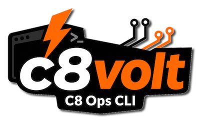

# c8volt v5 — operations for Camunda 8.10

**v5 brings Camunda 8.10 support and a consistent flag grammar for inspection, repair, and cleanup.** Camunda 8.9 and 8.8 remain supported. Documentation and examples target 8.10; version-specific features are marked **only c8.10+**.



`c8volt` is an independent Camunda CLI for DevOps teams. Inspect running work, repair incidents, preview bulk changes, and wait for observable outcomes. It is not an official Camunda product.

<!-- docs-index-exclude-start -->
[Documentation](https://c8volt.info) · [Releases](https://github.com/grafvonb/c8volt/releases)
<!-- docs-index-exclude-end -->

## What's new in v5

- Camunda 8.10: native business IDs, process suspension and resumption, definition lifecycle state, and suspended-instance statistics.
- Clear flag intent: bare properties select resources, `--set-*` supplies values to write, and `--with-*` adds query detail.
- Operational playbooks for analysis, repair, retention, and purge, with previews and audit reports.

v5 is a breaking CLI release. Update scripts to the current grammar; renamed flags have no legacy aliases. `--retries` filters jobs; `--set-retries` changes retries. `--set-timeout` changes a job timeout; `--timeout` controls HTTP requests only.

## Fast start

Download and unpack the matching archive from [Releases](https://github.com/grafvonb/c8volt/releases). Put `c8volt` on your `PATH` and create `config.yaml` next to the binary:

```yaml
app:
  camunda_version: "8.10"
apis:
  camunda_api:
    base_url: "http://localhost:8080"
auth:
  mode: "none"
```

Use `auth.mode: oauth2` or `cookie` for protected clusters; see [configuration](https://c8volt.info/configuration/). Set the version to match your cluster. If the config lives elsewhere, pass `--config /path/to/config.yaml`.

```bash
c8volt config validate
c8volt config test-connection
c8volt get cluster topology
c8volt get process-definition --latest
```

## Start with an ops playbook

Use `--dry-run` to inspect a repair or cleanup plan before changing data. Discovery fixes the target set before confirmation; an empty completed search makes no changes.

| Task | Command | Guide |
| --- | --- | --- |
| Find slow instances | `ops analyse slow-process-instances` | [Analysis](docs/ops/analyse-slow-process-instances.md) |
| Repair incidents | `ops repair incident` | [Incident repair](docs/ops/repair-incident.md) |
| Repair an instance | `ops repair process-instance` | [Instance repair](docs/ops/repair-process-instance.md) |
| Remove old finished instances | `ops execute retention-policy` | [Retention](docs/ops/execute-retention-policy.md) |
| Purge incident-affected families | `ops purge process-instances-with-incidents` | [Incident purge](docs/ops/purge-process-instances-with-incidents.md) |
| Remove orphan instances | `ops purge orphan-process-instances` | [Orphan purge](docs/ops/purge-orphan-process-instances.md) |
| Remove definitions and history | `ops purge all-process-definitions` | [Definition purge](docs/ops/purge-all-process-definitions.md) |
| Check deployment and runtime | `ops execute smoke-test` | [Smoke test](docs/ops/execute-smoke-test.md) |

```bash
c8volt ops analyse slow-process-instances --bpmn-process-id order --state active --dur-longer 5m
c8volt ops repair incident --key <incident-key> --set-retries 3 --dry-run
c8volt ops execute retention-policy --retention-days 90 --bpmn-process-id order --dry-run
```

## Inspect and change individual resources

Each example uses the full command name. Short aliases such as `pi`, `pd`, and `ut` remain available in command help. Replace `<...>` placeholders with real keys.

```bash
# Inspect an instance and its incident context.
c8volt get process-instance --key <process-instance-key> --with-incidents
c8volt walk process-instance --key <process-instance-key> --with-elements

# Preview a variable repair, then resolve the incident.
c8volt update process-instance --key <process-instance-key> --set-vars '{"approved":true}' --dry-run
c8volt ops repair process-instance --key <process-instance-key> --set-vars-file vars.json

# Restore job retries or complete a user task.
c8volt update job --key <job-key> --set-retries 3 --dry-run
c8volt update user-task --key <user-task-key> --complete --set-vars '{"approved":true}'
```

Deploy and start work:

```bash
c8volt deploy process-definition --file order.bpmn
c8volt run process-instance --bpmn-process-id order --set-vars '{"customerId":"1234"}'
c8volt expect process-instance --key <process-instance-key> --state completed
```

Use `--bid ORDER-123` to select an exact native business ID and `--set-bid ORDER-123` to assign one (**only c8.10+**). Business IDs are literal strings, independent of process variables. Post-creation assignment requires an active root without an ID and uniqueness disabled.

Suspend or resume a process instance (**only c8.10+**):

```bash
c8volt suspend process-instance --key <process-instance-key> --dry-run
c8volt resume process-instance --key <process-instance-key>
```

Add `--tree` to include eligible descendants. Suspension retains runtime state; it does not stop running worker code or undo external effects.

## Flag grammar

| Intent | Examples |
| --- | --- |
| Select existing resources | `--key`, `--state`, `--bid`, `--assignee`, `--retries` |
| Supply values to write | `--set-vars`, `--set-vars-file`, `--set-retries`, `--set-assignee`, `--set-bid` |
| Add returned detail | `--with-stats`, `--with-vars`, `--with-incidents`, `--with-elements` |
| Choose an action | `--complete`, `--fail`, `--throw-bpmn-error`, `--unassign` |
| Control execution | `--dry-run`, `--auto-confirm`, `--timeout` |

A BPMN error uses `--throw-bpmn-error --set-error-code CODE`. In repair playbooks, `--set-retries 0` skips retry restoration.

## Scripts and operational safety

- Use `--json` for structured results and the exit status to detect failures. Supported commands return partial outcomes when some targets fail.
- Use `--keys-only` where supported for one key per line. Empty results produce no key output.
- Query results and machine output use stdout. Human mutation summaries and diagnostics use the configured logger; prompts use stderr.
- Use `--auto-confirm` for unattended approval. JSON mutations generally require it, `--automation`, or `--dry-run`; check command help for support. Replacing a task assignee still requires explicit permission or `--force`.
- `--batch-size` controls discovery page size; `--limit` caps selected matches. Family expansion can include additional relatives.
- Set `--tenant` to narrow discovery. `--all-tenants` clears that filter within authorized access. Explicit keys use backend authorization; creation and deployment require one tenant.
- Most mutations wait for an observed result. Where supported, `--no-wait` reports acceptance rather than confirmed completion. `run` confirms visibility, not process completion.
- Cancellation and deletion affect instance families. Preview first; `--force` permits cancellation of unfinished work during deletion.

Use `--verbose` for operational detail and `--debug` for redacted HTTP diagnostics. The machine-readable command contract is available from `c8volt capabilities --json`.

## Documentation and project

- [CLI reference](./docs/cli/index.md) and [command tree](docs/cli/command-tree.md)
- [Ops playbooks](docs/ops/index.md) and [configuration](https://c8volt.info/configuration/)
- [Contributing](./CONTRIBUTING.md), [security](./SECURITY.md), and [trademarks](./TRADEMARKS.md)
- [License](./LICENSE), [copyright](./COPYRIGHT), and [notices](./NOTICE.md)

(c) 2026 Adam Bogdan Boczek · [boczek.info](https://boczek.info)
