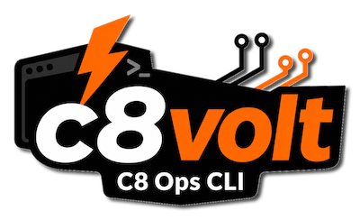

> Generated from build `c8volt v4.4.0-296-gaa4e1e45-dirty`, commit `aa4e1e45`, built `2026-11-04T08:30:18Z` | Supported Camunda 8 versions: 8.8, 8.9, 8.10 | Camunda 8.10 baseline: 8.10.3 (final)

# c8volt v5 — Camunda 8.10 operations

**v5 brings Camunda 8.10 support, native user-task operations, explicit variable scopes, business IDs, process suspension and resumption, and a consistent flag grammar.**



**Operator-grade Camunda 8 control for people and pipelines. Script-safe and built to finish the job.**

> **done is done**
>
> If an action needs retries, waiting, tree traversal, state checks, cleanup, or deterministic machine output before it is truly finished, c8volt should do that work for you.

`c8volt` is an independent Camunda CLI for DevOps teams, developers, support engineers, CI pipelines, and AI agents. Deploy and inspect processes, operate user tasks and jobs, repair incidents, and clean up process families through commands that account for dependencies and verify observable outcomes.

## Done is done

Camunda accepting a request is often one step in an operational workflow. c8volt handles the discovery, traversal, retries, and confirmation needed to finish that workflow.

| Operation | What c8volt confirms by default |
| --- | --- |
| Deploy process definitions | Returned definitions become visible. |
| Start a process instance | The created instance becomes observable. |
| Cancel process instances | The affected family reaches terminal states or is absent. |
| Delete process instances | Deletion is observed after processing children before parents. |
| Update variables | Requested values are visible at their intended scopes. |
| Resolve incidents | The selected incidents are no longer active. |
| Suspend or resume instances | SUSPENDED after suspension; ACTIVE or COMPLETED after resumption. |
| Complete or assign user tasks | The native operation confirms the change, including blocking listener processing. |

Starting an instance confirms creation; use `expect process-instance --state completed` to wait for process completion. Job worker outcomes have their own acceptance contract and do not establish process completion.

Where supported, `--no-wait` returns after acceptance. It retains prerequisite checks needed to continue a workflow. If a request was accepted but required confirmation fails, c8volt reports the distinction and returns a failure.

## What's new in v5

| Area | What it adds |
| --- | --- |
| **Native user tasks** | Keyed lookup and paginated search; assignee, candidate, state, and local-variable filters; effective variables including inherited values; assignment, unassignment, completion, and variable updates for one or multiple explicit tasks. |
| **Variable scopes** | Inspect and update variables at explicit runtime-element scopes. Task updates preserve existing variable ownership and create new names locally; previews identify write destinations. Process-instance updates target root scope. |
| **Native business IDs** | Create, display, and select by business ID; assign an ID after creation; assign an ID atomically with job completion (c8.10+). IDs are literal strings, independent of process variables. |
| **Suspension and resumption** | Suspend or resume selected instances, optionally including eligible descendants with `--tree`; inspect and wait for suspended state (new in c8.10). |
| **Definition lifecycle** | Inspect ACTIVE, DRAINING, and DELETED states, separate active/suspended statistics, and cleanup that includes suspended instances (new in c8.10). |
| **Operational controls** | Optional API request pacing and a gateway-version advisory, plus smoke-test cleanup covering deployed dependency definitions. |
| **Consistent flag intent** | Select with properties, write with `--set-*`, and request additional detail with `--with-*`. Renamed flags have no legacy aliases. |

Post-creation business-ID assignment requires an active root without an ID and uniqueness disabled. Suspension retains runtime state; it does not stop running worker code or undo external effects.

## Standard commands for everyday operations

Inspect process definitions and instances, walk execution trees, and examine runtime elements, variables, incidents, jobs, and execution/task listeners. Cluster, license, tenant, and resource inspection complement deployment, recovery, and cleanup commands. See the [command tree](./cli/command-tree) for the complete surface.

Deploy, start, and wait for completion:

```bash
c8volt deploy process-definition --file order.bpmn
c8volt run process-instance --bpmn-process-id order --set-vars '{"customerId":"1234"}'
c8volt expect process-instance --key <process-instance-key> --state completed
```

Inspect execution and preview changes:

```bash
c8volt get process-instance --key <process-instance-key> --with-elements --with-listeners
c8volt update process-instance --key <process-instance-key> --set-vars '{"approved":true}' --dry-run
c8volt update job --key <job-key> --set-retries 3 --dry-run
c8volt resolve incident --key <incident-key> --dry-run
```

Search and operate native user tasks:

```bash
c8volt get user-task --assignee alice --with-vars --limit 10
c8volt update user-task --key <user-task-key> --set-assignee alice --dry-run
c8volt update user-task --key <user-task-key> --complete --set-vars '{"approved":true}'
```

Inspect and change an exact runtime-element scope:

```bash
c8volt get element --key <element-instance-key> --with-vars
c8volt update element --key <element-instance-key> --set-vars '{"approved":true}' --dry-run
```

Suspend or resume an instance and its eligible descendants (new in c8.10). Ancestors and siblings are excluded:

```bash
c8volt suspend process-instance --key <process-instance-key> --tree --dry-run
c8volt resume process-instance --key <process-instance-key> --tree
```

Replace `<...>` placeholders with real keys. Short aliases such as `pi`, `pd`, and `ut` remain available in command help.

## Cancellation and deletion understand process families

A selected instance may belong to a larger execution tree. c8volt follows its ancestry to the root and discovers the affected descendants. Selecting one child can therefore affect its parent, siblings, and other descendants. Overlapping selections are grouped by root.

Use `walk` to inspect those relationships and `--dry-run` to preview the mutation scope:

```bash
c8volt walk process-instance --key <child-instance-key> --with-incidents
c8volt cancel process-instance --key <child-instance-key> --force --dry-run
c8volt delete process-instance --key <root-instance-key> --force --dry-run
```

**Cancellation** operates on the relevant roots and waits until affected family members are completed, canceled, terminated, or absent. Selecting a child for cancellation requires `--force` to authorize cancellation of its root.

**Deletion** processes children before parents. Unfinished instances require `--force`, which authorizes prerequisite cancellation. When deletion encounters an unfinished-instance conflict, c8volt cancels the relevant root, confirms the required terminal state, and retries deletion. That prerequisite confirmation remains necessary with `--no-wait`.

After reviewing the preview, execute the cleanup:

```bash
c8volt delete process-instance --key <root-instance-key> --force
```

Filters select starting instances; traversal determines the affected family. `--limit` bounds selected matches, not the number of relatives affected. Empty completed searches finish without confirmation or mutation.

Definition cleanup checks unfinished work before deletion. With `--force`, it cancels affected roots, verifies that no unfinished instances remain, and coordinates instance-history and definition deletion. Suspended instances count as unfinished (c8.10+). Deferred history deletion without a returned batch cannot be independently confirmed by definition disappearance; see [delete process-definition](./cli/c8volt_delete_process-definition).

## Why choose c8volt for operations?

`c8ctl` is Camunda's official CLI. **Choose c8volt when your runbook needs dependency handling, impact previews, and confirmed operational outcomes.**

`c8volt` reduces the custom scripting needed around Camunda operations. Its commands carry family traversal, prerequisite cancellation, retries, and state confirmation through execution. Review the affected scope, approve the change, and see which outcomes were confirmed and which still need attention. JSON results and failure exit codes make the same workflows usable in CI.

That operational depth extends across process instances, user tasks, variable scopes, jobs, and incidents. For special cases, `ops` orchestrates several base operations into one previewable playbook with outcome reporting.

See [c8volt and c8ctl](https://c8volt.info/camunda-cli/) for the operational comparison. c8volt is an independent project, not an official Camunda product.

## Camunda version support

Camunda 8.9 and 8.8 remain supported. Examples target Camunda 8.10.

Feature availability follows the API available to c8volt for each version. Native business-ID workflows, suspension/resumption, and definition lifecycle support require c8.10+. Operations that need newer endpoints or state information cannot be provided through older API contracts; c8volt reports them as unsupported.

## Ops playbooks

`c8volt ops` orchestrates the operations exposed by multiple base commands into one playbook. For example, incident repair can inspect incidents and jobs, update variables, restore retries, resolve incidents, and verify the result.

These playbooks are a c8volt highlight for special operational cases: incident recovery, retention, dependency cleanup, and end-to-end verification. Mutation workflows coordinate discovery, planning, approval, execution, confirmation, and reporting. Preview repair and cleanup with `--dry-run`; follow each guide for details.

| Task | Command | Guide |
| --- | --- | --- |
| Explain slow execution | `ops analyse slow-process-instances` | [Analysis](./ops/analyse-slow-process-instances/) |
| Repair selected incidents | `ops repair incident` | [Incident repair](./ops/repair-incident/) |
| Repair an instance's incidents | `ops repair process-instance` | [Instance repair](./ops/repair-process-instance/) |
| Remove old finished instances | `ops execute retention-policy` | [Retention](./ops/execute-retention-policy/) |
| Purge incident-affected families | `ops purge process-instances-with-incidents` | [Incident purge](./ops/purge-process-instances-with-incidents/) |
| Remove orphan instances | `ops purge orphan-process-instances` | [Orphan purge](./ops/purge-orphan-process-instances/) |
| Remove definitions and history | `ops purge all-process-definitions` | [Definition purge](./ops/purge-all-process-definitions/) |
| Verify deployment and runtime | `ops execute smoke-test` | [Smoke test](./ops/execute-smoke-test/) |

## Fast start

Download and unpack the matching archive from [Releases](https://github.com/grafvonb/c8volt/releases). Put `c8volt` on your `PATH` and create `config.yaml` in your working directory:

```yaml
app:
  camunda_version: "8.10"
apis:
  camunda_api:
    base_url: "http://localhost:8080"
auth:
  mode: "none"
```

Use `auth.mode: oauth2` or `cookie` for protected clusters; see [configuration](https://c8volt.info/configuration/). Set the version to match your cluster. If the config lives elsewhere, pass `--config /path/to/config.yaml`.

```bash
c8volt config validate
c8volt config test-connection
c8volt get cluster topology
c8volt get process-definition --latest
```

## AI agents and automation

AI agents can discover the CLI contract, preview a change, and execute it without interactive prompts:

- `capabilities --json` describes command paths, flags, output modes, mutation behavior, and automation support.
- `--automation` enables unattended execution on commands that explicitly support it, including approval of mutations. Selection rules, force requirements, and normal outcome confirmation still apply.
- `--json` returns structured results on stdout. Diagnostics stay separate; use the exit status and available partial outcomes to assess failures.

Discover, preview, then execute a repair:

```bash
c8volt capabilities --json
c8volt --automation --json ops repair incident --key <incident-key> --set-retries 3 --dry-run
c8volt --automation --json ops repair incident --key <incident-key> --set-retries 3
```

Inspect command support before choosing flags or output modes. A preview and a later execution discover their scopes separately. See [AI and agent context](https://c8volt.info/ai-search-context/) for the full discovery guidance.

## Flag grammar and scripting

v5 is a breaking CLI release. Update scripts to the current grammar; renamed flags have no legacy aliases.

| Intent | Examples |
| --- | --- |
| Select existing resources | `--key`, `--state`, `--bid`, `--assignee`, `--retries` |
| Supply values to write | `--set-vars`, `--set-vars-file`, `--set-retries`, `--set-assignee`, `--set-bid` |
| Add returned detail | `--with-stats`, `--with-vars`, `--with-incidents`, `--with-elements` |
| Choose an action | `--complete`, `--fail`, `--throw-bpmn-error`, `--unassign` |
| Control execution | `--dry-run`, `--auto-confirm`, `--timeout` |

`--retries` filters jobs; `--set-retries` changes retries. `--set-timeout` changes a job timeout; `--timeout` controls HTTP requests only. A BPMN error uses `--throw-bpmn-error --set-error-code CODE`. In repair playbooks, `--set-retries 0` skips retry restoration.

- Use `--json` for structured results and the exit status to detect failures. Supported commands retain partial outcomes when some targets fail.
- Use `--keys-only` where supported for one key per line. Empty results produce no key output.
- Query results and machine output use stdout. Human mutation summaries and diagnostics use the configured logger; prompts use stderr.
- Use `--auto-confirm` for unattended approval. JSON mutations generally require it, `--automation`, or `--dry-run`; check command help. Replacing a task assignee still requires explicit approval or `--force`.
- `--batch-size` controls discovery page size; `--limit` caps selected matches. Family expansion can include additional relatives.
- Set `--tenant` to narrow discovery. `--all-tenants` clears that filter within authorized access. Explicit keys use backend authorization; creation and deployment require one tenant.

Use `--verbose` for operational detail and `--debug` for redacted HTTP diagnostics.

## Documentation and project

- [CLI reference](./cli/) and [command tree](./cli/command-tree)
- [Ops playbooks](./ops/) and [configuration](https://c8volt.info/configuration/)
- [Contributing](https://github.com/grafvonb/c8volt/blob/main/CONTRIBUTING.md), [security](https://github.com/grafvonb/c8volt/blob/main/SECURITY.md), and [trademarks](https://github.com/grafvonb/c8volt/blob/main/TRADEMARKS.md)
- [License](https://github.com/grafvonb/c8volt/blob/main/LICENSE), [copyright](https://github.com/grafvonb/c8volt/blob/main/COPYRIGHT), and [notices](https://github.com/grafvonb/c8volt/blob/main/NOTICE.md)

(c) 2026 Adam Bogdan Boczek · [boczek.info](https://boczek.info)
