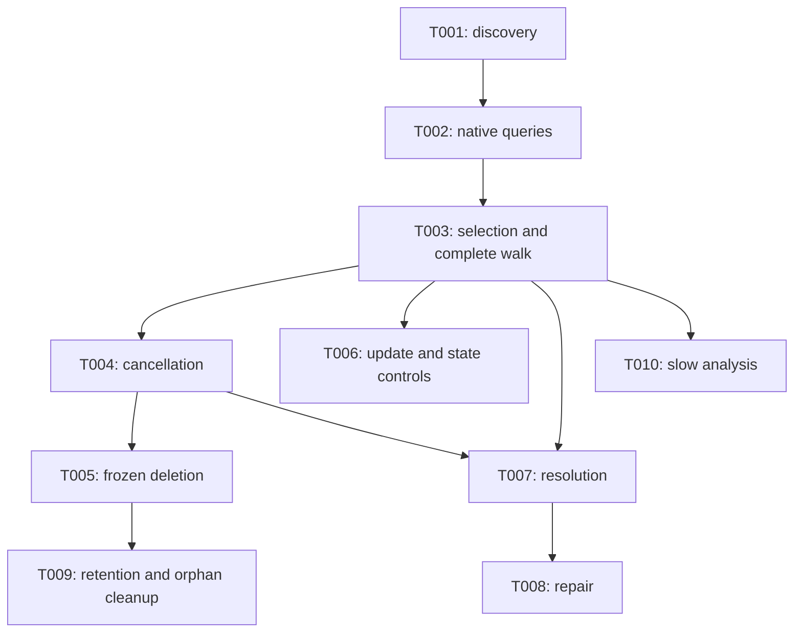

# Tasks: Business-ID Filters and Process Selection

**Input**: [plan.md](plan.md), [spec.md](spec.md), [research.md](research.md), [data-model.md](data-model.md), [contracts](contracts/), and [quickstart.md](quickstart.md).

**Branch / issue**: `361-business-id-selection` / #361. Depends on the existing #360 business-ID creation/views work; #203 and #239 are not dependencies.

**Organization**: Each checkbox is one cohesive, compiling implementation outcome, including necessary fixtures, tests, formatting, documentation and targeted validation. Paths are repository-relative. Named new files are proposed and may be created in the owning package. US5 acceptance applies inside each delivery task; it is not deferred to final polish.

## Execution and validation rules

Read the feature artifacts, `AGENTS.md`, constitution, and `specs/ralph-implementation-rules.md` before implementation. Follow existing package ownership; keep paging, selection, traversal, plans, retries/waits and mutation execution in internal services. Facades only copy/map/delegate/convert errors. Every interface change includes all implementations and required test-double updates in that same task. Keep a distinct CLI lifecycle in a focused mode file; final formatting belongs in view files. No new generated-client edits, dependency, generic selector framework or per-command BID resolver is needed.

Tests are explicitly required by the specification. Write meaningful failing regressions first where they characterize the new behavior, then implement and pass them within the same task. Do not commit a broken interface or a tests-only red intermediate task. Reuse owned fixtures; never replace required command, real-terminal, logging or exit-path tests with renderer-only assertions. Comment new/materially modified declarations and tests per repository rules.

Use only isolated mocks, owned HTTP servers and CLI/subprocess/PTY fixtures. Before running any target, inspect it and clear inherited live/helper/build switches using [quickstart.md](quickstart.md). No real Camunda endpoint, integration tag/target, smoke test, target discovery, cluster inspection, provisioning or cleanup is authorized by these tasks. List the intended new tests before execution; zero matched tests is not a pass.

Every task includes targeted `gofmt` on touched Go files. Every user-visible task updates its command metadata/help/examples and relevant `README.md` guidance, then runs `make docs-content`; generated CLI docs are never hand-edited. Explicitly document public interface/custom-implementation and optional-field compatibility when applicable. Record checks, coverage limitations and progress with the work unit; issue-associated commit subjects end in ` #361`.

### Shared acceptance obligations

These obligations are part of the named tasks, not additional tasks or optional later checks. For grouped commands, share fixtures and policy assertions but exercise every affected command path; do not multiply unrelated flag combinations or rebuild existing operation mechanics.

| Code | Acceptance obligation |
| --- | --- |
| Q | Actual command execution for native filters, combined predicates, tenant scope, paging/totals/enrichment, explicit-key/stdin exclusivity and omitted-input regressions; human/JSON/keys/quiet output as supported |
| M | Actual mutation execution for normal/dry-run/verbose/JSON/keys/quiet plus supported automation/auto-confirm/no-wait combinations; full discovery before mutation, exact request counts, partial outcomes and original failure/exit class |
| E | Authoritative empty discovery: zero confirmation/mutation, zero-byte empty keys, established human wording and JSON empty shape with exactly one envelope and EOF; quiet+machine results preserved; no-wait is success rather than accepted; sparse, abort and error paths never masquerade as empty success |
| L | Configured/inherited logger destinations, INFO human mutation/dry-run/verbose output with empty stdout, plain/structured formats, quiet/WARN suppression; repeated failures containing distinctive method/URL/body/key produce one bounded aggregate ERROR with no raw HTTP data on either stream at normal/verbose/quiet; redacted DEBUG via flag and configured level independently; preserve machine evidence, one envelope/EOF and original exit code; assertions detect direct-print/raw-error substitutions |
| T | Real terminal stdin with separately captured streams; prompt-free completed empty scopes; eligible nonempty approve/decline/EOF and redirected-output behavior; plain configured stderr prompts; report platform skips accurately |
| V | v810 exact opaque BID; v88/v89 reject supplied BID before backend search/mutation including bypass/empty/prepared-plan paths; nil BID and default version unchanged; no fabricated related-resource IDs |
| R | Defensive pointer/slice/map copies, exact criterion and selected-versus-expanded provenance through confirmed execution and existing JSON/Markdown reports; safe text/Markdown escaping, unchanged schema identifiers and absence conventions, no render-triggered reads |

### Targeted validation groups

Commands below run only during implementation under the quickstart isolation wrapper. Each task specifies its groups and focused patterns; adapt patterns to the actual newly added tests and require matches. Start with the changed owner package, then its facade/command path. Do not rerun unrelated suites just to commit.

| Group | Command pattern |
| --- | --- |
| PI | `go test ./internal/services/processinstance/... -run 'Test.*(BusinessID|Search|Selection|Children|Traversal|DryRun|SelectedMutation|Delete|Discover)' -count=1` |
| Task | `go test ./internal/services/usertask/... -run 'Test.*(BusinessID|Search)' -count=1` |
| Process facade | `go test ./c8volt/process -run 'Test.*(BusinessID|Search|Selection|Convert|Walk|Plan|Update|Resolve|Suspend|Resume)' -count=1` |
| Task facade | `go test ./c8volt/task -run 'Test.*(BusinessID|Search|Convert)' -count=1` |
| Ops | `go test ./internal/services/ops ./c8volt/ops -run 'Test.*(BusinessID|Repair|Retention|Orphan|Slow|Convert)' -count=1` |
| Incident | `go test ./internal/services/incident/... ./c8volt/incident -run 'Test.*(BusinessID|Resolve|Resolution|Plan)' -count=1` |
| Command | `go test ./cmd -run '<task-specific Test pattern>' -count=1` |

Run any new common/domain helper's targeted tests plus at least one consumer. After the last executable feature change has passed targeted validation, the task delivering that change owns one `make test PKG=./...` run with integration tags disabled: shared discovery, traversal, frozen plans and conversions justify the race-enabled breadth. Do not defer failing behavior to a final testing task or repeat the full suite for prose-only changes.

## Phase 1: Setup

The project, dependencies, branch and feature artifacts already exist. No initialization task is needed. Context reading, branch checks and progress bookkeeping are responsibilities of every work unit rather than standalone checkboxes.

## Phase 2: Foundational — trustworthy process discovery

**Goal**: Existing process search exposes reliable completion and distinct selection accounting for later query, uniqueness and mutation consumers.

**Independent test**: Owned page fixtures distinguish exhaustion, user limit, visitor stop and incomplete discovery, including duplicate/sparse/cyclic pages, with no command/facade page loops.

- [x] T001 Implement trustworthy service-owned process paging in `internal/services/processinstance/search.go`, `internal/domain/processinstance.go`, `c8volt/process/model.go`, `c8volt/process/client.go`, and `c8volt/process/convert.go`, with matching tests in `internal/services/processinstance/search_test.go` and `cmd/get_processinstance_search_test.go`. Add completion values `exhausted`, `limit_reached`, `visitor_stopped`, `incomplete`; enforce “An unset/unknown disposition is not success.” Preserve partial evidence plus original errors, deduplicate keys before selected limits, advance using raw backend progress, continue sparse pages, validate metadata/cursor progress, and fix counted totals without changing exact-compatible totals or existing query prompt policy. Keep facade/visitor mappings and affected stubs compiling together. Include Q/E regression cases and targeted PI, process-facade and command `Test.*(ProcessInstance.*(Search|Paging)|GetProcessInstance|ConfirmationEmptySelectorResults)` checks.

**Acceptance details**: Cover cursor and offset fallback, exact and lower-bound totals, terminal probes where supported, empty page with more data, repeated cursor/offset overflow or no progress, visitor stop and context cancellation. Unknown continuation must resolve authoritatively or fail incomplete, never silently succeed. Partial results must not reset to an apparently completed empty slice. Keep ordinary query eligibility/continuation wording and selected-format output stable; document any actual public-result additions with the task.

## Phase 3: US1 — Find Work by Its Business Reference (P1, MVP)

**Goal**: Operators and library callers search PIs and user tasks by exact BID through native payloads, complete paging, totals and enrichment.

**Independent test**: Actual CLI/public requests against owned native endpoints prove the exact BID, AND predicates and tenant scope; old versions reject without requests; task snapshots remain independent of current PI identity.

- [x] T002 [US1] Deliver native BID search for process instances and user tasks through the existing domain, facade and versioned search owners in `internal/services/processinstance/` and `internal/services/usertask/`. Implement the shared presence/value/version policy once, wire both native payloads and CLI filters, and validate both resource identities in this work unit.

- **PI search:** Deliver native PI BID query support through `internal/domain/processinstance.go`, `c8volt/process/model.go`, both filter directions in `c8volt/process/convert.go` and `c8volt/ops/convert.go`, `internal/services/processinstance/api.go`, all three PI adapters' `service.go`, v810 `convert.go`, and `cmd/get_processinstance_filtering.go` / `cmd/get_processinstance_search.go`. Use `BusinessId *string` with `json:"businessId,omitempty"`: “nil means omitted; pointer to empty is invalid” and “No creation-length constraint is introduced.” Add a narrow shared search-input policy, no-I/O `ValidateProcessInstanceSearchFilter` in every adapter/stub, custom-payload exact scalar encoding and BID-only `isEmpty()` handling; disable direct-incident-index lookup at both CLI and service boundaries. Register/populate/detect/validate scalar `--bid` without enabling undeveloped mutation modes. Include native serialization, pointer/description round trips, AND/tenant/exclusivity/enrichment/totals and Q/E/L/V tests beside each owner; update README/help/generated docs and run PI, process-facade, ops-converter and command `Test.*(BusinessIDSelection|GetProcessInstance)` checks.
- **User-task search:** Deliver native task BID query support in `internal/domain/usertask.go`, `c8volt/task/model.go`, `c8volt/task/convert.go`, `internal/services/usertask/v88/search.go`, `internal/services/usertask/v89/search.go`, `internal/services/usertask/v810/search.go`, `internal/services/usertask/search.go`, and `cmd/get_usertask.go` / `cmd/get_usertask_search.go`. Use copied optional `BusinessId` with “nil means omitted; pointer to empty is invalid” and “Native task-level exact matching”; reuse the input policy delivered in this task without importing creation length rules. Populate the native exact scalar, register/detect `--bid`, preserve task-key/stdin exclusivity while AND-combining `--pi-key`, other native predicates and variables. Verify task-level stored BID differs from current PI BID without an extra PI lookup, plus Q/E/L/V and conversion-copy cases in adjacent search/facade/command suites. Include README/help/generated docs; run Task, task-facade and command `Test.*(BusinessIDSelection|GetUserTask)` checks.

**Acceptance details**: A library caller forcing `DirectIncidentIndex=true` cannot bypass BID; a later-page BID match must not be lost to an earlier incident limit. Validate before early/empty routes. Reject explicit empty/invalid UTF-8; preserve valid commas, spaces, Unicode, numeric-looking and literal wildcard values exactly, including values longer than creation's limit. Nil input leaves v88/v89 behavior unchanged. Keep all interface implementations/test doubles in this task, and share the validator with later task/ops callers without a capability framework.

**Checkpoint**: T001–T002 form the MVP: both searches are usable independently of mutations, with their US5 output/version obligations already passing.

## Phase 4: US2 — Walk One Unambiguous Process Family (P1)

**Goal**: Prove a unique starting instance and traverse its requested relationships completely.

**Independent test**: Zero/one/multiple distinct matches, duplicate observations, bounded/stopped/failing discovery, and a family with more than 1000 children demonstrate correct cardinality and traversal before a walk is accepted.

- [x] T003 [US2] Deliver complete BID walk selection and traversal in `internal/services/processinstance/selection.go`, `internal/services/processinstance/v810/service.go` and `cmd/walk_processinstance.go`. Reuse the completed search engine for cardinality and exhaustive child discovery; build the shared collection/unique selector with its first walk consumer.

- **Traversal completeness:** Remove silent v810 family truncation in `internal/services/processinstance/v810/service.go:GetDirectChildrenOfProcessInstance`, reusing T001 paging and existing `internal/services/processinstance/traversal/result.go` / `internal/services/processinstance/walker/walker.go` behavior without adding a command loop. Enforce “A limit-reached seed selection can be complete within its bound while additional matches exist globally; expansion for those selected seeds must still complete without clipping.” Exhaust direct-child pages at every depth, propagate unknown/cyclic continuation, later-page errors and cancellation as incomplete traversal, and retain observations needed for later family membership/order. Add owned >1000-sibling, deeper-child and sparse/error fixtures in versioned/traversal tests and `cmd/walk_test.go`; preserve older adapter behavior unless a shared correction is required. Update affected walk/suspend/resume metadata, README and generated v810 limitation guidance; run focused PI traversal/children and command `Test.*(WalkProcessInstance|SuspendProcessInstance|ResumeProcessInstance)` checks.
- **Selection and walk:** Implement shared `ResolveProcessInstanceSelection` and BID walk delivery in proposed `internal/domain/processinstance_selection.go`, `internal/services/processinstance/selection.go`, `c8volt/process/selection.go`, matching API/model/converter files, and `cmd/walk_processinstance.go` with a focused selector file when required. Support cardinalities `collection` and `unique_start`: “Two distinct keys sharing a BID remain two selections” and “Unique-start never treats a limit as exhaustive; it returns a precondition/ambiguity error on a second distinct key and otherwise requires exhaustion.” Copy criteria/observations/keys/tenant evidence, preserve selection origin, and keep configured tenant discovery separate from explicit-key ignore-tenant execution options. Replace required-key/enrichment validators with key-or-BID logic; exhausted zero matches render existing empty output without a walk. Include direct-library and actual-command cardinality, complete traversal/enrichment, source-options, Q/E/L/T/V tests and docs. Run focused PI selection, process-facade and command `Test.*(BusinessIDSelection|WalkProcessInstance)` checks with all interface/stub changes included.

**Acceptance details**: Matching instances in one family remain ambiguous. A repeated record for one key does not. Stop/limit/error after one observation cannot establish uniqueness. Public consumers retain errors and non-executable partial evidence. Enriched, parent/children/full-family, flat/tree and keys-only paths obey their established option combinations. The resolver is reused by all later collection consumers, not reimplemented per command.

## Phase 5: US3 — Apply Existing Process Actions to a Safe Selection (P1)

**Goal**: Complete, reviewable BID selection feeds each existing action's proper scope and frozen execution behavior.

**Independent test**: Each action executes against owned graphs/pages, showing complete selection before mutation, correct scope, no re-selection after approval and unchanged partial/wait/exit behavior.

- [x] T004 [US3] Deliver frozen cross-family BID cancellation in `internal/services/processinstance/selection.go` / `dryrun.go`, `internal/domain/processinstance_selection.go`, `c8volt/process/selection.go` and its API/converters, proposed `cmd/cancel_processinstance_business_id.go`, `cmd/cancel_processinstance.go` / `cancel_processinstance_selector.go`, and `cmd/cmd_views_processinstance_dryrun.go`. Compose complete bounded selection with one global ancestry/root/family expansion, retain parent/member provenance and deduplicate all sets; enforce “A seed limit must not clip required relatives.” Add plan validation/execution that rechecks the receiving adapter before even empty/prebuilt plans and submits only frozen distinct roots through existing bulk cancellation. No mutations from page visitors. Include full counts plus untruncated JSON/verbose/keys scope, M/E/L/T/V/R fixtures, docs and targeted PI/process-facade/command `Test.*(BusinessIDCancel|CancelProcessInstance|ProcessInstanceDryRun)` checks. Build collection and single-match behavior together; keep all API/stub updates in this unit.

**Mandatory cancellation fixture**: Implement [contracts/cancellation.md](contracts/cancellation.md): tenant-A seeds `A1,A2,B1`, roots `RA,RB`, affected union `RA,A1,A1a,A2,RB,B1,B2`; counts 3/2/7 and 4 additional relatives. Include duplicate `A1`, sparse pages, multiple seeds in one family, distinct families, other/absent BID relatives, and excluded tenant B. One planning expansion per distinct root; zero mutations/prompts in dry-run; zero mutation on late search/child-page error; 1001-child scope never clipped. Limit 2 selects two distinct family-A seeds and all four affected members. A new independent BID root after approval is never submitted. Preserve native cascade timing, root-force semantics, wait/no-wait, original partial failures, exact empty payloads and legacy non-BID paging UX. Tests must prove full JSON/verbose membership and deduplicated keys, not only counts.

- [ ] T005 [US3] Deliver BID deletion from frozen members in proposed `internal/services/processinstance/selected_delete.go`, `internal/services/processinstance/v810/service.go`, necessary internal API/all-version implementations and stubs, selected-plan domain/facade files, proposed `cmd/delete_processinstance_business_id.go`, existing delete dispatch/selector and dry-run views. Reuse T004 selection/expansion and preserve “Frozen affected members and observed children-before-parent order; exact planned submission without recursive live discovery.” Factor exact-key state/force/retry/wait mechanics from recursive deletion; never pass frozen roots unchanged to a function that discovers new child targets. Validate criteria/tenant/operation/capability at consumption, retaining guards and legacy explicit-key behavior. Include after-approval new-child/conflict, partial failure, force, order, no-wait and M/E/L/T/V/R regressions in adjacent service/facade/command suites plus docs; run focused PI deletion/selected-mutation, process-facade and command `Test.*(BusinessIDSelection|DeleteProcessInstance|ProcessInstanceDryRun)` checks.

**Acceptance details**: The fake adds a child after approval: no delete request may target it, and any resulting backend conflict remains a failure. Existing force root cancellation retains native cascade semantics; it does not authorize client-side scope rediscovery. Keep the frozen deletion executor reusable by retention/orphan without copying recursion or changing unrelated command families. Test a v810-built and an empty BID plan on v88/v89: unsupported before all mutation requests.

- [ ] T006 [US3] Connect BID collection selection to existing update, suspend and resume plans in `cmd/update_processinstance.go`, `cmd/suspend_processinstance.go`, `cmd/resume_processinstance.go` and their service owners. Carry the same validated selection provenance through each existing plan/execution path; preserve action-specific scope and exercise each command.

- **Variable update:** Add collection BID selection to variable updates in `cmd/update_processinstance.go` and a focused selector file, `internal/services/processinstance/update.go`, existing `c8volt/process` update API/converters and `cmd/cmd_views_processinstance_update.go`. Use T003 once, then existing `PlanProcessInstanceVariableUpdates` / `ExecuteProcessInstanceVariableUpdates` with copied criterion and payload; retain “Existing per-instance variable-update plans and payloads” and “no automatic family expansion.” Keep discovery tenant-scoped and revalidate prepared-plan capability without erasing genuine explicit-key authorization. Include multiple matches, payload immutability, variable scope, changed matches after confirmation, local exact-key preview request-count regression, M/E/L/T/V/R tests, README/help/generated docs; run focused owner update/selection, process-facade and command `Test.*(BusinessIDSelection|UpdateProcessInstance)` checks.
- **Suspend and resume:** Add BID collection selection to both suspend and resume in `cmd/suspend_processinstance.go`, `cmd/resume_processinstance.go`, their existing `_batch.go` / `_tree.go` lifecycles and view files, reusing T003 and `internal/services/processinstance/suspend_plan.go` / `resume_plan.go` with thin facade mapping. Preserve “Exact selected distinct instances” by default and descendant-plan `TargetKeys` for `--tree`, with “no ancestors/siblings.” Keep criterion/source evidence and capability validation through frozen execution, and bypass keyed no-input errors only for proven completed empty selection. Share fixtures and mechanical selection glue instead of implementing two resolvers. Include state eligibility, overlapping descendants, tenant options, late discovery failure, frozen targets, M/E/L/T/V/R cases for each action, docs and focused PI/process-facade/command `Test.*(BusinessIDSelection|SuspendProcessInstance|ResumeProcessInstance)` checks.

- [ ] T007 [US3] Deliver BID-selected process resolution with reviewed work preserved in `cmd/resolve_processinstance.go` plus a focused selector file, `c8volt/incident/client.go` / `api.go`, `internal/services/incident/resolve.go` / `bulk.go`, and the existing incident domain/facade plan/API owners. Reuse T003 selection and existing family expansion; separate read-only incident/job/variable planning from execution where needed so “any incident/job/variable actions shown for approval must be captured in the owner service's plan before approval.” Preserve incident resolution actions, per-instance results and errors without a direct incident BID filter or discovery repeated by toggling dry-run. Keep changed interfaces/stubs together. Include overlap/tenant/new-incident-after-approval, later planning failure with zero writes, M/E/L/T/V/R coverage, docs and focused Incident and command `Test.*(BusinessIDSelection|ResolveProcessInstance)` checks.

**Checkpoint**: All eight process command paths apply BID through actual execution. Cancellation/deletion use complete global plans; update, resolution and state controls retain their own action scope. Every delivered action already passes its US5 obligations.

## Phase 6: US4 — Narrow Operational Work and Preserve Its Evidence (P2)

**Goal**: Four operations retain exact BID criteria through discovery, reviewed scope, execution and supported reports.

**Independent test**: Each operation's fresh and confirmed/public paths use owned pages and copied plans; mutation targets and report round trips remain stable while fake discovery changes during confirmation.

- [ ] T008 [US4] Deliver BID process-instance repair and immutable confirmation handoff in `internal/domain/ops_repair.go`, `internal/services/ops/repair.go`, `c8volt/ops/model.go` / `convert.go` / `client.go`, `cmd/ops_repair_processinstance.go`, `cmd/ops_repair.go`, repair views and `cmd/ops_report_repair.go`. Reuse T003 and T007 reviewed incident mechanics; preserve original `ProcessInstanceSelection` separately from frozen PI/incident/job/variable actions instead of clearing it or discovering again after confirmation. Add copied typed `FrozenPlan` with `json:"-"`: “A plan is not authorization to bypass backend checks.” Check known service version/input before empty/key/plan bypasses, reject BID plus bare unproven keys, count distinct matching incident-eligible PIs, and retain report shapes. Include selector detection, duplicated converters, changed incident set at approval, M/E/L/T/V/R tests, docs; run focused Ops, Incident and command `Test.*(BusinessIDOperations|OpsRepairProcessInstance|OpsRepair)` checks.

- [ ] T009 [US4] Deliver frozen BID cleanup for retention and orphan purge in `internal/services/ops/retention_policy.go`, `internal/services/ops/orphan_purge.go` and their command/facade owners. Apply the same complete-plan confirmation handoff and frozen deletion executor to both, preserving their distinct eligibility and limit units.

- **Retention:** Deliver BID retention with a frozen deletion handoff in `internal/domain/ops_retention_policy.go`, `internal/services/processinstance/retention_discovery.go`, `internal/services/ops/retention_policy.go`, ops public model/converters/client, `cmd/ops_execute_retention_policy.go` and its views/report writers. Reuse T003 and T005; preserve the original BID plus fixed derived end-date boundary, selected observations, skipped/non-final roots, blockers and frozen membership/order. Add copied `FrozenPlan` with `json:"-"`, validate version/context/readiness before key/empty bypass, and never rebuild reviewed expansion from only `DiscoveredKeys`. Limits count “Distinct matching instances frozen for cleanup”; repair sparse/duplicate discovery through the shared engine. Include boundary/state/force cases, late child conflict with no unplanned delete, M/E/L/T/V/R coverage, docs; run PI retention discovery, Ops and command `Test.*(BusinessIDOperations|OpsExecuteRetentionPolicy)` checks.
- **Orphan purge:** Deliver BID orphan purge with documented candidate limits and frozen deletion in `internal/domain/ops_orphan_purge.go`, `internal/services/processinstance/orphan_discovery.go`, `internal/services/ops/orphan_purge.go`, ops public model/converters/client, `cmd/ops_purge_orphan_processinstances.go` and its views/report writers. Reuse shared selection/continuation and T005 deletion; keep `HasParent`/orphan-parent eligibility, copied typed `FrozenPlan` with `json:"-"`, original BID and complete reviewed scope. Enforce “Distinct matching child candidates inspected, before orphan classification”: a non-orphan consumes the limit, duplicates do not. Replace the contradictory `TestDiscoverOrphanProcessInstancesLimitCountsOrphansNotCandidates` expectation and document this intentional correction for all callers. Include sparse pages, zero-orphan bounded completion, unknown/missing parent semantics, pre-bypass version checks, no new deletion targets, M/E/L/T/V/R coverage, docs; run PI orphan discovery, Ops and command `Test.*(BusinessIDOperations|OpsPurgeOrphanProcessInstances)` checks.

- [ ] T010 [US4] Deliver BID-only and definition+BID slow analysis in `internal/domain/ops_slow_process_analysis.go`, ops public filter/model/converters, `internal/services/ops/slow_process_analysis.go`, `cmd/ops_analyse_slow_process_instances.go`, its validation/progress files and views. Use copied optional `BusinessId` with “nil means omitted; pointer to empty is invalid”; retain `explicit_keys` and `process_definition_search` and “Add `process_instance_search` for BID-only requests.” Allow at most one definition selector and require BID or that selector in search mode, preserving key/search exclusivity. Reuse T003 distinct bounded discovery; update all mode/preflight/progress/filter summaries and supported report paths. For BID discovery confirm only after an actual match exists, before enrichment. Include sparse unknown-total all-empty real-PTY zero-prompt/zero-enrichment, later nonempty approve/decline/EOF, Q/E/L/T/V/R and mode round-trip tests, docs; run Ops and command `Test.*(BusinessIDOperations|OpsAnalyseSlowProcessInstances)` checks and, if this is the final runtime task, the single full race suite.

**Checkpoint**: Original criteria survive confirmation and JSON/Markdown where supported; the selector is never fabricated as a resource observation. No new report format or BID selector outside the explicit scope is introduced.

## Phase 7: US5 — Keep Version and Automation Contracts Dependable (P2)

**Goal**: Consistent version rejection, output streams, prompts, machine formats and failure evidence across the delivered surface.

**Independent test**: Run the applicable Q/M/E/L/T/V/R fixtures attached to T002–T010 through actual commands with owned dependencies. Both old versions reject BID before requests, including prepared plans and ops bypasses; JSON yields exactly one envelope/EOF; repeated human backend failures are compact logged records with independent redacted DEBUG; real-terminal empty scopes never prompt.

There are no standalone US5 tasks: each behavior unit owns these acceptance criteria before it can be checked complete. This follows the plan and repository rule against deferring necessary tests/output correctness to a separate polish pass. T001 also carries existing-query output and completion regression obligations. US5 is complete only when every applicable matrix row is covered by the owning completed task and no required mode/version path is unverified. Reuse common fixture code, but each new execution path must be exercised.

## Phase 8: Polish and cross-cutting completion

No separate cleanup, documentation, generic review or test-only tasks are added. Formatting, metadata, README, generated docs, output diagnostics, progress evidence and targeted checks belong to each outcome. The final executable unit owns the single justified full race suite. Preserve the specification and existing planning evidence; do not run live validation or launch Ralph as part of task generation.

## Dependencies and execution order

The default execution order is T001 through T010, grouped by primary story for Ralph. The table records the real functional prerequisites; shared model/API/view/docs files still require serialized editing even when two dependency branches are independent.

| Task | Depends on | Delivered prerequisite/result |
| --- | --- | --- |
| T001 | Existing #360 baseline | Trustworthy process discovery/total protocol |
| T002 | T001 | Native PI and task BID queries, shared policy and conversions; US1 complete |
| T003 | T001, T002 | Shared cardinality resolver, exhaustive child lookup and BID walk; US2 complete |
| T004 | T003 | Frozen family planner, global preview and BID cancellation |
| T005 | T004 | Frozen-member deletion executor and BID deletion |
| T006 | T003 | BID integration with existing variable-update and exact/tree state-control plans |
| T007 | T003, T004 | Reviewed process-family/incident resolution |
| T008 | T003, T007 | Frozen repair plan and retained provenance |
| T009 | T003, T005 | Retention/orphan eligibility, frozen cleanup handoff and reports |
| T010 | T003 | BID-only slow analysis and delayed preflight |

The diagram shows primary delivery dependencies; the table is authoritative. US3/US4 reuse earlier query/selection behavior rather than duplicating it. US5 is embedded throughout and has no separate execution node.

## Parallel execution examples by story

No implementation task is marked `[P]`: shared process/ops interfaces, converters, view contracts and generated documentation make concurrent edits unsafe without further isolation. Do not split cohesive tasks merely to create parallel work.

| Story | Safe opportunity after that task's edits are complete |
| --- | --- |
| US1 | Independently run owned PI adapter and task adapter test processes once their respective input/conversion changes compile; serialize metadata/doc generation |
| US2 | Independently run traversal fixtures and resolver/facade suites after shared models stabilize; command global-state tests retain their existing nonparallel discipline |
| US3 | Independently run service-plan tests and command subprocess/PTY tests with owned fixtures; serialize edits to shared plans/views and do not share mutable backend fixtures |
| US4 | Independently run operation-service and facade round-trip suites after the operation's copied models compile; serialize shared ops converter/report edits |
| US5 | Isolated version and logger-destination subprocess cases can execute concurrently only where existing test helpers guarantee independent state; no package-global flag/command parallelism |

These are validation opportunities within completed code changes, not a request to spawn agents or execute tests while generating tasks.

## Requirement and acceptance ownership

| Requirement/criterion | Owning tasks |
| --- | --- |
| FR-001–FR-003, V/input presence/opaque values | T002, enforced again by T003–T010 consumers |
| FR-004–FR-006, Q/native AND/task identity/shortcut/totals | T001–T002 |
| FR-007–FR-008, all eight process paths and tenant authorization | T002, T003–T007 |
| FR-009–FR-010, distinct complete collection/limits/continuation | T001, T003–T010 |
| FR-011, unique walk | T003 |
| FR-012, command-specific scope | T003–T007 |
| FR-013–FR-014, complete frozen scope/provenance | T003–T009, with report evidence in T010 |
| FR-015–FR-016, E/no-op/dry-run/local key behavior | T002–T010 |
| FR-017, four operations | T008–T010 |
| FR-018, BID-only slow analysis | T010 |
| FR-019, R/ops conversions/reports | T002, T008–T010 |
| FR-020–FR-023, M/E/L/T/modes/partial failure/diagnostics | Every exposed path in T002–T010; T001 query regressions |
| FR-024, help/README/generated docs | Each user-visible task T002–T010 and any visible correction in T001 |
| SC-001–SC-002 | T002–T010 query/selection/tenant fixtures |
| SC-003–SC-004 | T001, T003–T010 incomplete/ambiguous/global-union fixtures |
| SC-005 | E/L/T attached to every exposed command task |
| SC-006 | R in T002, T003–T010 |
| SC-007 | V in T002–T010 including prebuilt-plan/bypass execution |
| SC-008 | Metadata/README/doc generation in every visible delivery unit |
| Explicit multi-family cancellation clarification | T003–T004: full fixture, counts, traversal, global union, full preview and freeze; T005/T009/T009 add frozen deletion safety |

## Implementation strategy

Deliver T001–T002 first as the native-search MVP, with its version/output contracts complete. Next deliver exhaustive traversal and unique walk, then collection mutations using the same resolver and planner. Add maintenance operations and slow analysis through their existing owners. At each checkpoint, use isolated acceptance evidence; do not deploy/demo against a real environment as an implementation gate.

Each checkbox is a cohesive work unit within its primary story scope; follow the Ralph rules for the current iteration. The foundational protocol correction is a shared prerequisite, not a cross-story feature batch. Tasks with service, facade, command and tests together are intentional cohesive outcomes, not permission to implement later tasks in the same iteration. Keep existing-plan adapters together and reuse selection/fixture contracts; do not rebuild single-item support into collection support later.

**Counts**: 10 tasks: foundational 1; US1 1; US2 1; US3 4; US4 3; US5 0 standalone (acceptance embedded). Setup/polish have no standalone tasks. All tasks begin unchecked; no implementation or runtime validation has been performed by generating this file.
